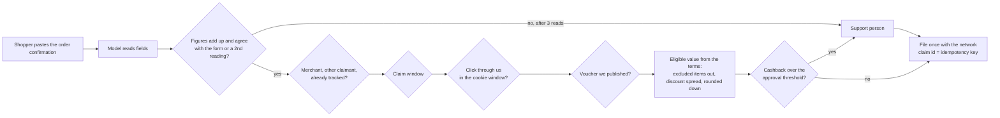
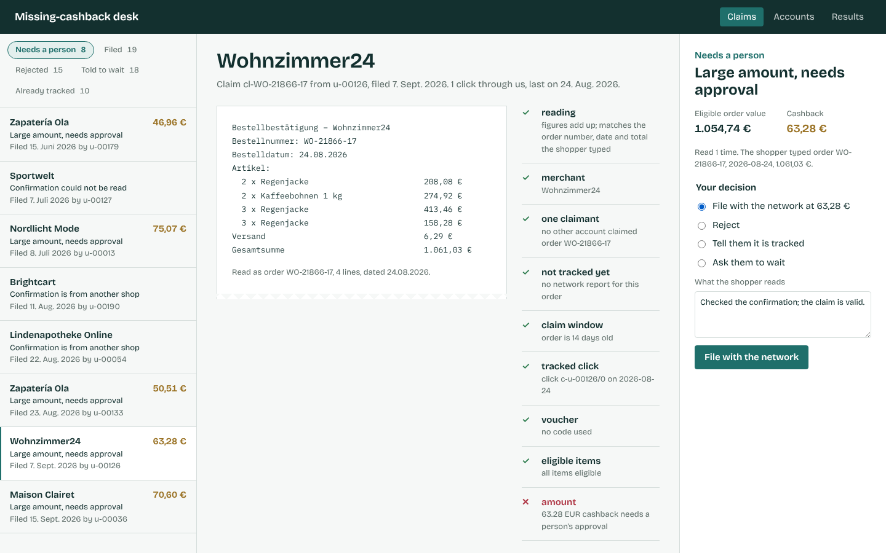

# cashback-claims-ledger

The services behind a cashback platform's rewards, online and in store, in **Java 21 and Spring Boot 4**. Affiliate networks and a card scheme report purchases late, twice and out of order. The ledger keeps every report as a fact and computes each reward from the set, so a balance is exact to the cent whatever arrives when. When tracking breaks, shoppers file **missing-cashback claims**. A model reads the pasted order confirmation, and code decides from the terms, the click log and the ledger. A support person takes only what code cannot settle.

REST and signed webhooks, an SQS consumer for EventBridge, DynamoDB and Postgres stores, an Apollo Federation subgraph that extends `User` with cashback, Prometheus metrics, a hash-chained audit trail, and a React + Framer Motion support console. Every number below is generated by `./gradlew :eval:evaluate` and checked by CI.

## Dashboard

| | the desk | support decides every claim | a model alone |
|---|---|---|---|
| Claims decided right | **99.3%** | 96.5% | 67.4% |
| Invalid claims sent to networks | **0.4%** | 8.1% | 50.5% |
| Filed at the wrong amount | **0** | 3 | 58 |
| Valid cashback denied | **€330.35** | €387.11 | €997.16 |
| Support hours | **16.2** | 268.5 | 0.0 |
| Answered later than 7 days | **0** | 0 | 0 |

| ledger, after 36,008 deliveries (3,853 repeats, 1,258 out of order) | keep facts | apply as they arrive |
|---|---|---|
| Shoppers whose balance is exact to the cent | 100.0% | 90.5% |
| Cents off, all shoppers | €0.00 | €3,021.43 |
| Rewards in the wrong state | 0 | 578 |
| 8 parallel consumers agree with one | yes | |

The desk's right share is 2.8 points higher than support deciding every claim (90% interval 2.0 to 3.6, paired bootstrap over the same claims), with 6.0% of the support hours. The world: 6,000 shoppers, 14,217 online orders, 6,262 card transactions, 1,790 claims (2026-05-01 to 2026-09-27, seed `dev-2026-11`).

## All four claim designs

| design | right | filed | invalid of filed | wrong amount | valid cashback denied | cashback recovered | support hours | late |
|---|---|---|---|---|---|---|---|---|
| **Model reads, code decides, a person takes the rest** | 99.3% | 510 | 0.4% | 0 | €330.35 | €11,224.01 of €12,281.19 | 16.2 | 0 |
| Support agents decide every claim | 96.5% | 544 | 8.1% | 3 | €387.11 | €11,017.18 of €12,281.19 | 268.5 | 0 |
| Rules on the shopper's form, no reading | 73.2% | 568 | 12.9% | 355 | €478.67 | €3,340.27 of €12,281.19 | 17.3 | 0 |
| A model reads and decides alone | 67.4% | 965 | 50.5% | 58 | €997.16 | €9,550.81 of €12,281.19 | 0.0 | 0 |

The gate in `config/gate.json` was written before the first result: right at least 95%, at most 3% of filed claims invalid, at most 0.5% at a wrong amount, nobody answered late, at most 30% of the support hours, better than every other design, and a ledger exact to the cent. `./gradlew :eval:gate` checks it in CI.

Where the desk is still wrong, on dev:

| truth → what the desk did | claims |
|---|---|
| eligible → REJECT | 8 |
| already_tracked → WAIT | 3 |
| fraud → FILE | 2 |

Fraud that slips through is a fraudster who clicked through us before copying someone else's confirmation and claimed first; nothing the platform sees tells them apart until the real shopper claims too, which sends both to a person. An already-tracked claim told to wait is an order whose network report was still in a delivery delay when the claim arrived. The rest are the support person's own mistakes on the cases the desk handed over.

## Ledger consumers

| consumer | shoppers exact | cents off | rewards in the wrong state |
|---|---|---|---|
| Keep every fact, compute the reward from the set | 100.0% | €0.00 | 0 |
| Apply each event as it arrives | 90.5% | €3,021.43 | 578 |
| Drop repeated event ids, then apply in arrival order | 90.4% | €3,031.85 | 578 |

## Held-out world

A second world (seed `heldout-2026-11`, 5,000 shoppers, 1,735 claims, 2026-01-12 to 2026-06-10) with more hard scans, more fraud and noisier delivery, run once on 2026-11-15. Gate: **passed**.

| design | right | filed | invalid of filed | wrong amount | valid cashback denied | cashback recovered | support hours | late |
|---|---|---|---|---|---|---|---|---|
| **Model reads, code decides, a person takes the rest** | 99.2% | 556 | 0.9% | 1 | €121.94 | €12,218.83 of €13,109.04 | 17.4 | 0 |
| Support agents decide every claim | 95.5% | 573 | 8.4% | 3 | €850.23 | €11,538.85 of €13,109.04 | 260.3 | 0 |
| Rules on the shopper's form, no reading | 69.8% | 615 | 13.3% | 389 | €402.47 | €3,173.14 of €13,109.04 | 19.5 | 0 |
| A model reads and decides alone | 67.3% | 957 | 47.1% | 69 | €1,148.31 | €10,141.92 of €13,109.04 | 0.0 | 0 |

Ledger: 100.0% of shoppers exact to the cent, €0.00 off, after 31,250 deliveries.

What it showed and what changed afterwards (measured on dev only): [docs/heldout.md](docs/heldout.md).

## How a claim is decided



The checks run in the order the terms publish them (`config/terms.json`), and each decision carries its checks,
so the console shows a person exactly why. The model is asked for fields, never for a verdict; the pasted text
is wrapped as data and instructions inside it are just text (`ClaimDeskTest`).

## How the ledger stays exact

* **Facts, not updates.** A network's postback or a card scheme's authorisation, clearing or refund is stored
  as a fact under its event id. A reward is computed from its set of facts: the network's latest update wins by
  the network's own version; a card reward is the cleared amount less refunds (each refund id once), against the
  offer's minimum spend, cap, hold and authorisation expiry (`RewardFold`).
* **Compare-and-set everywhere.** Every write names the version it read; in-memory, Postgres (`version`
  column) and DynamoDB (conditional `PutItem`) implement the same contract and run the same contract test.
* **Payouts once.** A payout id is the idempotency key; two racing payout requests cannot both be paid, and a
  decline after payout leaves the shopper owing it, not the platform losing it (`LedgerTest`).
* **Signed and scoped intake.** Webhooks carry `X-Signature: sha256=<HMAC>`; a network can only report on its
  own merchants, and a batch is checked whole before any fact is applied. The SQS consumer deletes a message
  only after it is applied and leaves unreadable ones for the dead-letter queue.

## Modules

| module | what it is |
|---|---|
| `product` | ledger, claims desk, readers (layout and Claude), audit chain; standard library only |
| `service` | Spring Boot 4: REST, webhooks, GraphQL federation subgraph, Postgres, DynamoDB, SQS, Prometheus |
| `web` | React + Framer Motion support console |
| `world` | the simulated shoppers, merchants, networks, card scheme, claimants, model and support person |
| `eval` | runs the designs on the world; writes `reports/`, this README and `demo/seed.json` |
| `common` | JSON and keyed randomness |

`product` and `service` cannot see `world` or `eval`: the Gradle graph forbids it and `InvariantsTest` checks the
sources. The world reads only the published terms and its own `world.json`.

## API

| | |
|---|---|
| `POST /api/postbacks/{network}` | signed network postbacks (one fact or `{"events": [...]}`) |
| `POST /api/card-events` | signed card-scheme authorisations, clearings and refunds |
| `GET /api/users/{id}/account` | pending, confirmed, paid out, available or owed, and every reward |
| `POST /api/users/{id}/payouts` | `{"payoutId"}`, idempotent |
| `POST /api/claims` | a shopper's missing-cashback claim |
| `GET /api/claims?status=NEEDS_SUPPORT` | the support queue |
| `POST /api/claims/{id}/resolution` | a person's verdict with the reason the shopper reads |
| `POST /graphql` | the subgraph: `_service`, `_entities` for `User`, `claims` |
| `GET /actuator/prometheus` | metrics |

```graphql
query ($r: [_Any!]!) {
  _entities(representations: $r) {
    ... on User { id cashback { pendingCents confirmedCents availableCents rewards { id status cashbackCents } } }
  }
}
```

## Run it

```bash
./gradlew build                                   # every module, every test
./gradlew :eval:evaluate :eval:gate :eval:readme  # the numbers above
cd web && npm ci && npm run build && cd ..
./gradlew :service:bootRun                        # http://localhost:8790, demo data loaded
docker build -t cashback-claims-ledger . && docker run -p 8790:8790 cashback-claims-ledger
```

Keys for the demo: `support-demo-key` (support console) and `shopper-demo-key` (`u-demo`). With
`ANTHROPIC_API_KEY` set, Claude reads confirmations instead of the layout reader. `CASHBACK_STORE=dynamodb`,
`DATABASE_URL` and `SQS_QUEUE_URL` move state to AWS-style stores; CI runs them against DynamoDB Local,
Postgres 16 and ElasticMQ.



## Limits

The shoppers, merchants, affiliate networks, card scheme, the model in the evaluation and the support person are
simulated; the evaluation measures the decision logic and the ledger against that simulation, not against real
traffic. All merchants, networks and codes are fictional. The ledger, desk, readers, stores, API, subgraph and
console are real code that CI builds and tests. Claims are filed through an interface; the demo records them
instead of calling a real network.
